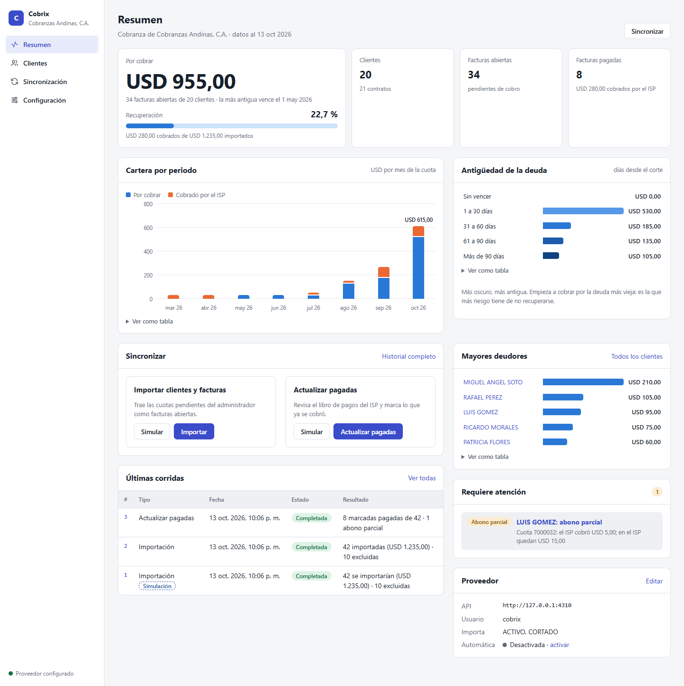
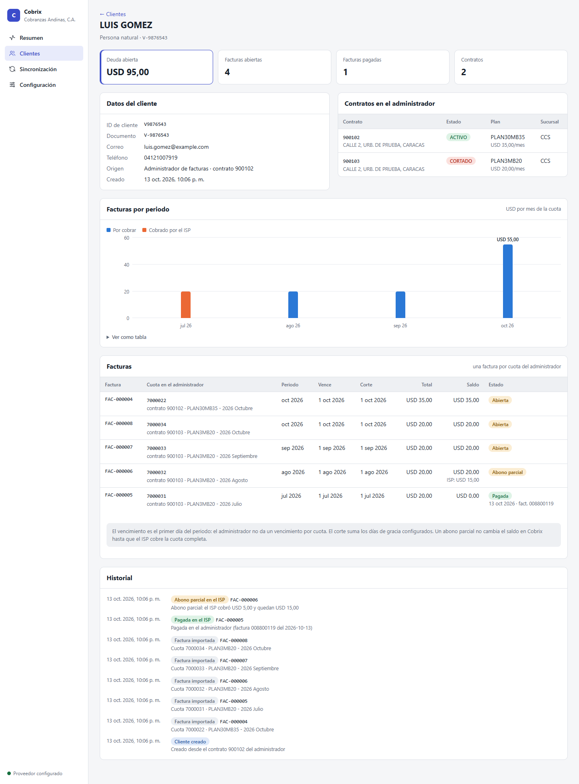
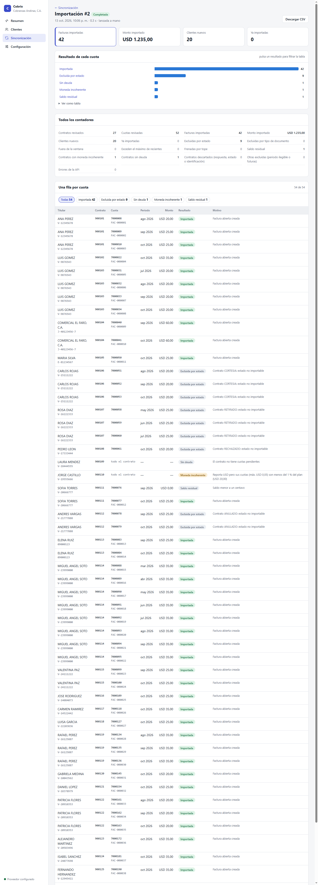
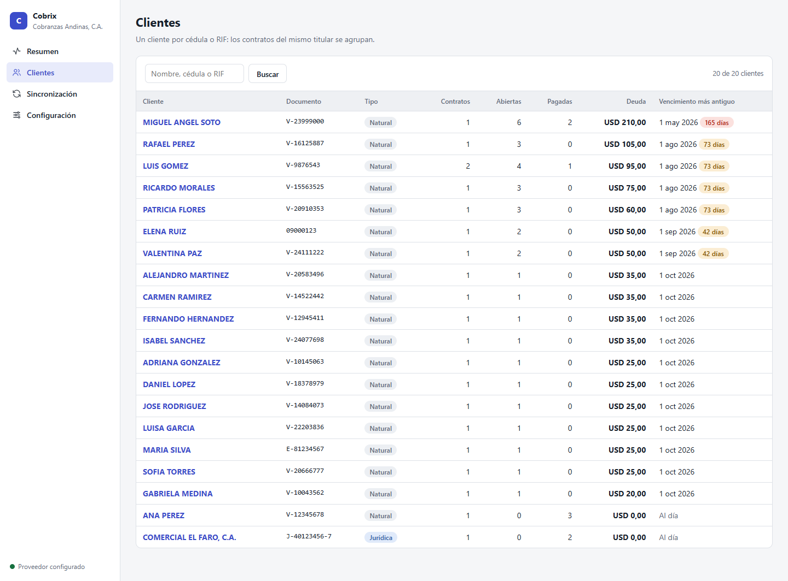
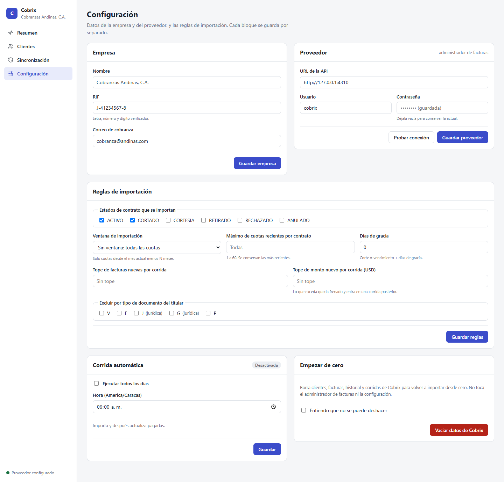
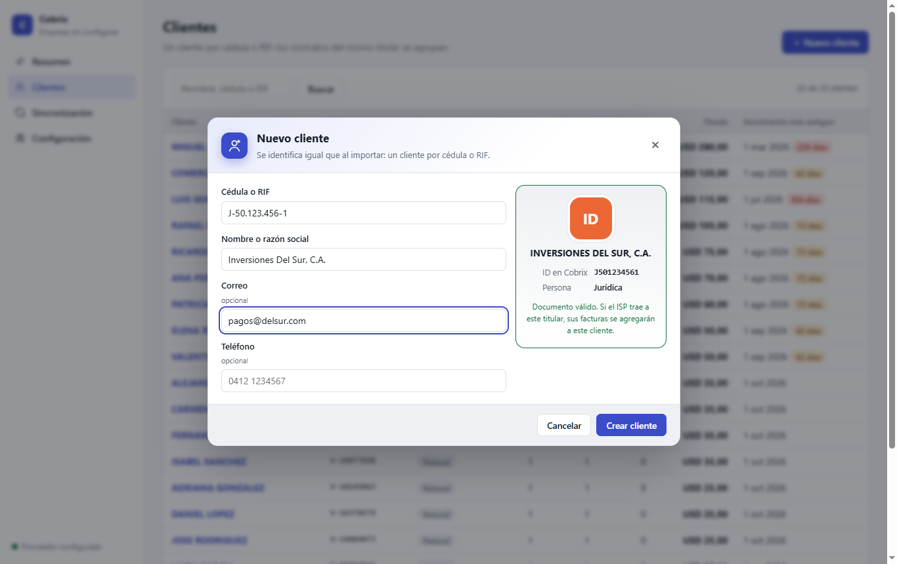
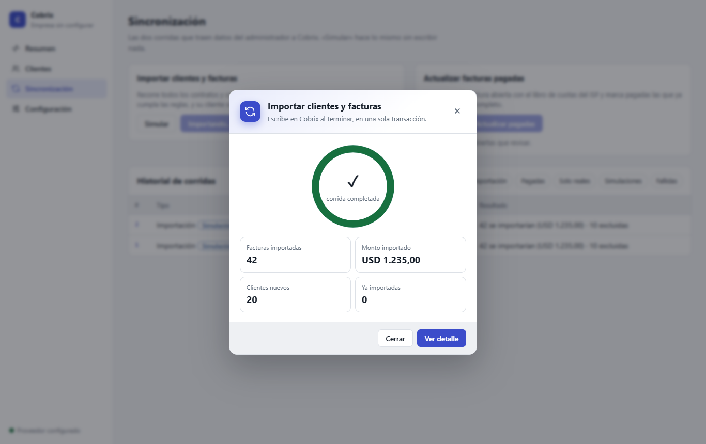
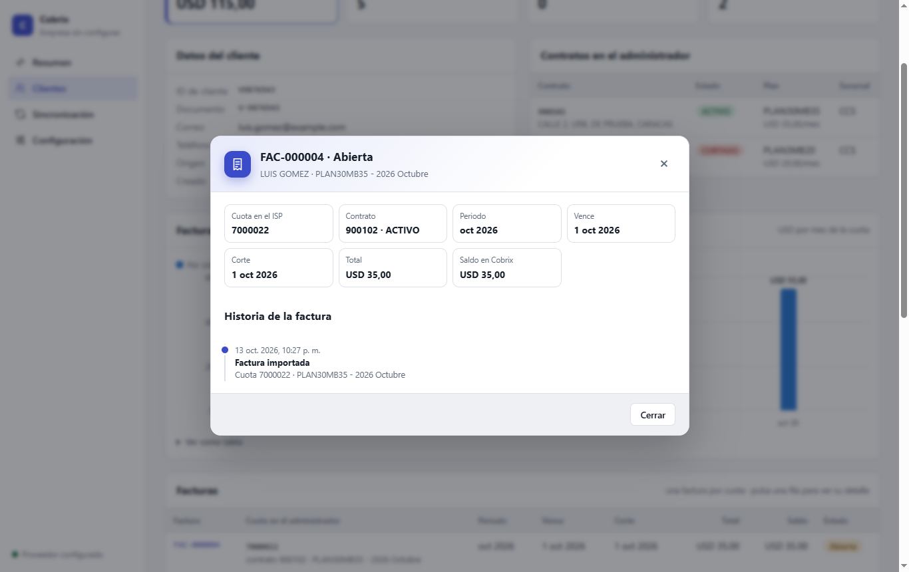
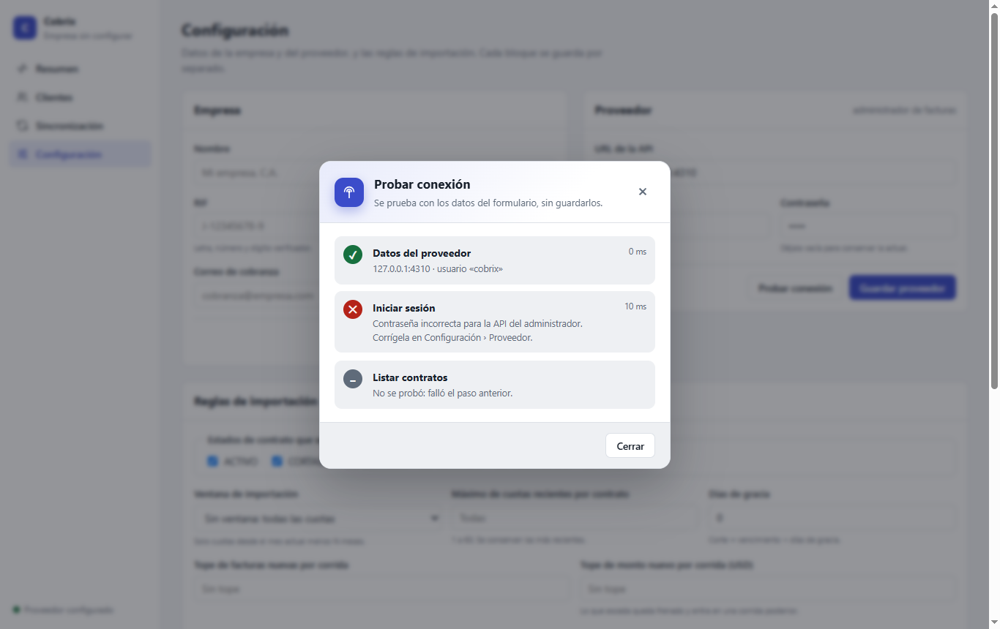

# Cobrix · integración con el administrador de facturas

Importa clientes y facturas desde la API del administrador de facturas de un ISP, aplica los pagos que el ISP ya cobró y ofrece un panel para operarlo: configuración, sincronización con simulación, historial de corridas con una fila por cuota, clientes y expediente.

| Documento | Qué contiene |
| --- | --- |
| [`docs/CRITERIOS.md`](docs/CRITERIOS.md) | **Cómo la entrega cubre cada criterio de evaluación**, con dónde verlo y cómo comprobarlo |
| [`NOTA.md`](NOTA.md) | Decisiones, lo que quedó fuera, lo que haría con más tiempo, punto diferencial y uso de IA |
| [`docs/ARQUITECTURA.md`](docs/ARQUITECTURA.md) | Diagramas: vista general, flujo de importación, árbol de decisión de pagos y modelo de datos |

🎬 **Video demo (2:31):** [`docs/video/demo.mp4`](docs/video/demo.mp4). Recorre cada criterio de evaluación con subtítulos.



<table>
<tr>
<td width="50%"><br><sub><b>Expediente</b>: totales, contratos, facturas por periodo e historial</sub></td>
<td width="50%"><br><sub><b>Detalle de corrida</b>: resultado de cada cuota con su motivo, filtrable y exportable a CSV</sub></td>
</tr>
<tr>
<td><br><sub><b>Clientes</b>: búsqueda por nombre, cédula o RIF</sub></td>
<td><br><sub><b>Configuración</b>: empresa, proveedor y reglas de importación</sub></td>
</tr>
</table>

### Modales

| | |
| --- | --- |
| <br><sub><b>Nuevo cliente</b>: la ficha muestra en vivo cómo se guarda el documento (misma normalización que la importación) y avisa si ya existe</sub> | <br><sub><b>Corrida</b>: anillo de progreso en vivo que termina en el resumen de la corrida</sub> |
| <br><sub><b>Detalle de factura</b>: datos del ISP y la historia de la factura</sub> | <br><sub><b>Probar conexión</b>: diagnóstico paso a paso que dice dónde falla</sub> |

Más capturas en [`docs/capturas/entrega/`](docs/capturas/entrega/), incluidas las de móvil.

## Levantarlo

Requiere **Node 24**. No hay dependencias de ejecución: Node 24 trae `node:sqlite`, `fetch` y ejecuta TypeScript directamente.

```bash
npm install     # solo TypeScript y tipos, para `npm run typecheck`
npm start
```

| Qué | Dónde |
| --- | --- |
| **Panel de Cobrix** | http://127.0.0.1:4300 |
| API del administrador | http://127.0.0.1:4310/api/v1 |
| Swagger (y el simulador de caja) | http://127.0.0.1:4310/docs |

En el primer arranque, el proveedor queda **precargado** con la API local (usuario `cobrix`, contraseña `cobrix-sandbox`), así que se puede sincronizar de inmediato. Todo se edita en *Configuración*.

Cobrix guarda sus datos en `data/cobrix.sqlite`, aparte de la base del administrador. Solo habla con el administrador por HTTP.

## Verificar los criterios de aceptación en 5 minutos

1. **Sincronización › Importar › Simular** → 42 cuotas se importarían; no se crea nada.
2. **Importar** → 20 clientes y 42 facturas abiertas por **USD 1.235,00**. En el detalle de la corrida, los filtros muestran las exclusiones: 9 por estado, 1 contrato por moneda incoherente, 1 saldo residual y 1 contrato sin deuda.
3. **Importar** otra vez → 0 nuevas y 42 «ya importadas».
4. En Swagger, sección **Simulador**, registra los pagos del enunciado (`POST /__sim/pagar` y `POST /__sim/anular`).
5. **Actualizar pagadas** → 8 pagadas, 1 abono parcial (LUIS GOMEZ) y **34 abiertas por USD 955,00**. Repetirla no cambia nada.

Para repetir desde cero: *Configuración › Empezar de cero* vacía Cobrix, y `POST /__sim/reiniciar` en Swagger devuelve el administrador a su estado inicial.

> Los pagos del simulador modifican `data/billing-api.sqlite`. Para dejarla como se entregó: `POST /__sim/reiniciar` o `git checkout data/billing-api.sqlite`.

## Pruebas

```bash
npm test             # 66 pruebas, sobre HTTP real contra una copia temporal del administrador
npm run typecheck
```

| Archivo | Qué cubre |
| --- | --- |
| `test/aceptacion.test.ts` | El ciclo completo del §5: simular → importar → reimportar → pagar y anular en la caja → simular actualización → actualizar → repetir |
| `test/reglas.test.ts` | Cada regla del §4 como función pura: identificación, periodo, estados, moneda, residuales, respuestas contradictorias, ventana, recientes, pagada, abono parcial, exonerada, sin evidencia y libro inconsistente; también los ejes de los gráficos |
| `test/robustez.test.ts` | Credenciales malas, API caída a mitad de la corrida (no queda nada a medias), error HTTP en un contrato, token vencido, corridas simultáneas, topes, días de gracia y la restricción `UNIQUE` |
| `test/panel.test.ts` | Formularios y validaciones, contraseña oculta, «Probar conexión», lanzar corridas, CSV, búsqueda, vaciar datos, corrida automática diaria y que el script del panel se ejecute sin errores |
| `test/clientes.test.ts` | Clientes creados a mano (validación, documento repetido escrito de otra forma, la importación los reutiliza sin duplicar), editar contacto, detalle de factura y diagnóstico de conexión |
| `test/entorno.test.ts` | La prueba entregada, adaptada: ahora comprueba las pantallas reales (ver la nota) |

## Cómo está hecho

Los diagramas completos están en [`docs/ARQUITECTURA.md`](docs/ARQUITECTURA.md).

```
src/cobrix/                 el lado de Cobrix
  api.ts                    cliente HTTP: token de 2 h con renovación, reintento ante 401, timeouts, errores legibles
  reglas.ts                 las reglas del §4 como funciones puras: clasificarContrato() y evaluarPago()
  sincronizacion.ts         las dos corridas (importar y actualizar pagadas), con simulación y progreso
  store.ts                  SQLite de Cobrix: config, clientes, contratos, facturas, eventos, corridas e ítems
  consultas.ts              lecturas para el panel: totales, cartera por periodo, antigüedad, mayores deudores, alertas
  programador.ts            corrida automática diaria (America/Caracas)
  clientes.ts               clientes creados a mano, editar contacto y detalle de factura
src/web/                    el panel, renderizado en el servidor y sin dependencias
  app.ts                    rutas, formularios (POST → redirect → GET), CSV y API de progreso
  vistas.ts                 las pantallas
  graficos.ts               gráficos en HTML/CSS con tooltip y vista de tabla (paleta validada para daltonismo)
  modales.ts                modales nativos (<dialog>): nuevo cliente, contacto, factura, corrida y conexión
  layout.ts, estilos.ts     base del esqueleto, más estilos y un script pequeño (opcional)
```

**El flujo de una importación:**
1. Recorre todos los contratos.
2. Clasifica la respuesta de cada uno con `clasificarContrato()`.
3. Decide en conjunto: qué ya existe, qué frena el tope y qué entra.
4. Escribe todo en **una transacción**. Si la API se cae a mitad de la corrida, no se escribe nada y la corrida queda como fallida con el motivo.

**El flujo de una actualización de pagadas:**
1. Lee el libro de cuotas por contrato.
2. Evalúa cada factura abierta con `evaluarPago()`.
3. Si una cuota no aparece en el libro (la del mes en curso, por ejemplo), consulta el contrato antes de concluir «sin evidencia».

### Resultado de cada cuota

| Importación | Cuándo |
| --- | --- |
| Importada | Pasa todas las reglas y no existía |
| Ya importada | Ya hay una factura de Cobrix con ese `deuda_id` |
| Excluida por estado / por tipo de documento | El estado del contrato o el tipo de documento del titular no se importan según la configuración |
| Fuera de la ventana / Excede recientes / Frenada por tope | Reglas de la configuración; nada se descarta en silencio |
| Saldo residual | `deuda` 0, saldo de menos de un centavo |
| Moneda incoherente | USD con cuotas de menos del 1 % del precio del plan (un solo ítem por contrato) |
| Sin deuda | La fila `deuda_id: "0"` (un ítem por contrato) |
| Respuesta inconsistente / Estado desconocido / Identificación inválida | El contrato queda fuera: no se adivina |
| Error de la API | Error HTTP en ese contrato; el resto de la corrida sigue |

| Actualizar pagadas | Cuándo |
| --- | --- |
| Marcada pagada | Todas las filas de la cuota coinciden, saldo 0 y algo pagado; se guarda la factura del ISP que la cobró |
| Abono parcial | El saldo en el ISP es menor que en Cobrix: se informa y la factura sigue abierta |
| Exonerada | Saldo 0 sin nada pagado: no es un pago |
| Sin evidencia | No aparece en el libro ni en el contrato: nunca se marca pagada |
| Libro inconsistente | Las filas de la cuota no coinciden entre sí, o la asocian a otro contrato |
| Sigue abierta | Sin cobros nuevos |

## Variables de entorno

| Variable | Por defecto | Para qué |
| --- | --- | --- |
| `PORT` / `BILLING_API_PORT` / `HOST` | `4300` / `4310` / `127.0.0.1` | Puertos y host |
| `COBRIX_DB` | `data/cobrix.sqlite` | Base de Cobrix |
| `SANDBOX_TODAY` | `2026-10-13` | Fecha de la prueba (la fija `npm start`) |

## Referencia del entorno entregado

El enunciado está en [`docs/ENUNCIADO.md`](docs/ENUNCIADO.md) (también en el panel, en `/enunciado`) y la guía de la API en [`docs/API.md`](docs/API.md). `src/billing-api/` y `data/billing-api.sqlite` no se modificaron.
