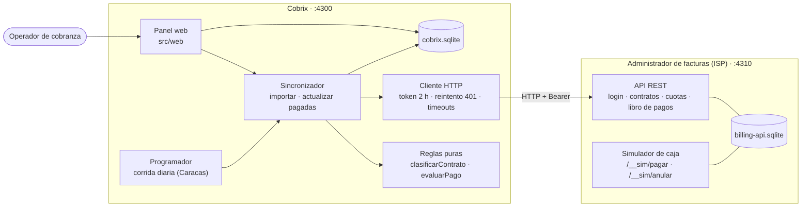
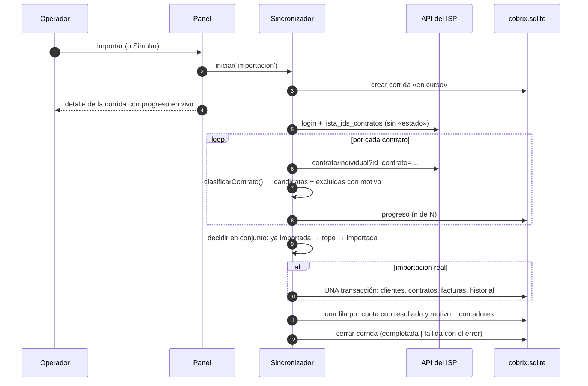
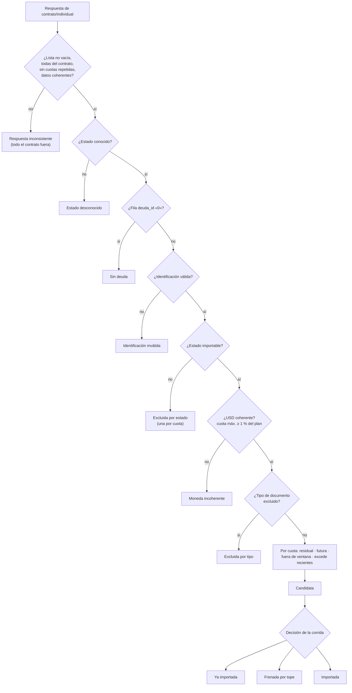
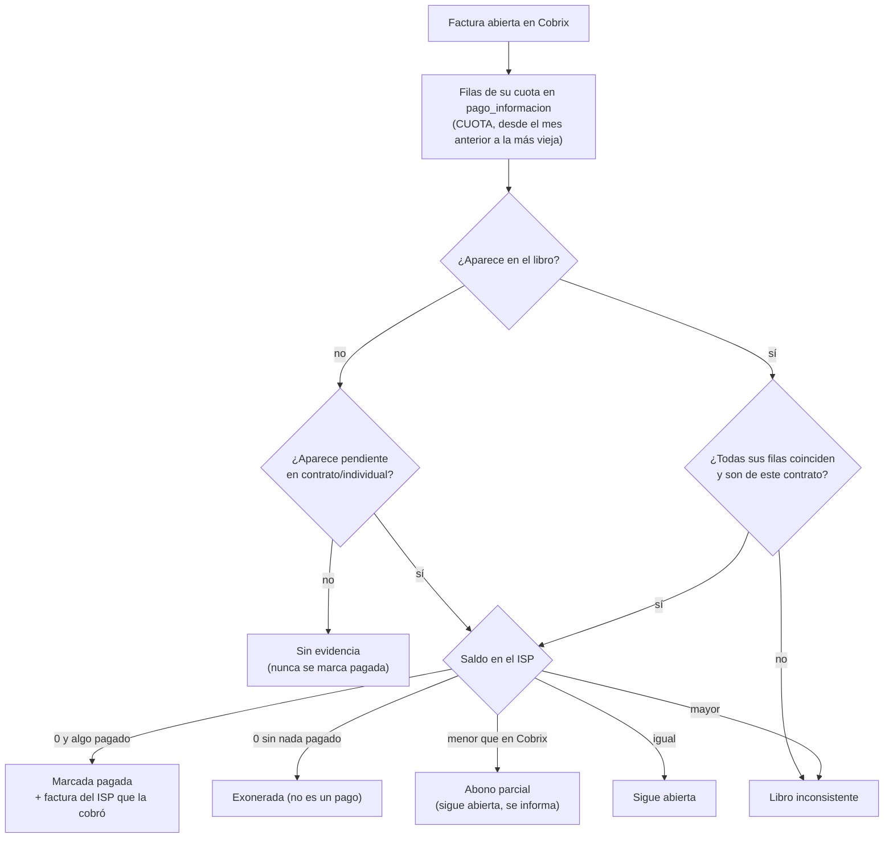
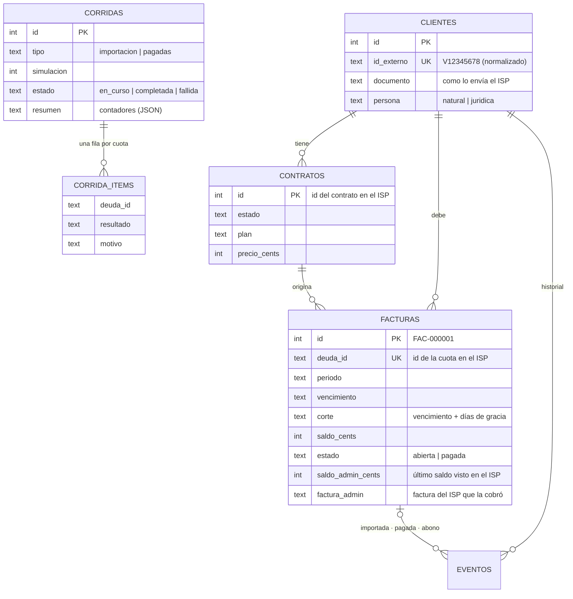

# Arquitectura

Cómo está construida la integración, con diagramas. Las decisiones y su porqué están en [`NOTA.md`](../NOTA.md); cómo levantarla y probarla, en el [`README`](../README.md).

## 1. Vista general

Cobrix **solo habla con el administrador por HTTP**, como lo haría con un ISP real, y guarda sus propios datos en una base aparte.

| Módulo | Responsabilidad | Depende de |
| --- | --- | --- |
| `src/cobrix/reglas.ts` | Interpretar la API: qué se importa, qué se excluye y por qué, qué está pagado | nada (funciones puras) |
| `src/cobrix/api.ts` | Hablar con la API: sesión, errores legibles | `fetch` |
| `src/cobrix/sincronizacion.ts` | Orquestar las corridas, decidir en conjunto, escribir en transacción | reglas, api, store |
| `src/cobrix/store.ts` | Esquema y acceso a `cobrix.sqlite` | `node:sqlite` |
| `src/cobrix/consultas.ts` | Lecturas para el panel (totales, cartera, antigüedad, alertas) | store |
| `src/cobrix/programador.ts` | Corrida automática diaria | sincronización |
| `src/web/*` | Panel: rutas, vistas, gráficos y estilos | todo lo anterior |

## 2. Importación

Si la API falla durante la lectura (pasos 5 a 8), **no se escribe nada**: la corrida queda fallida y con el motivo. Un error HTTP en un solo contrato se registra en ese contrato y la corrida sigue.

### Cómo se clasifica un contrato

## 3. Actualizar pagadas

Un pago **anulado** devuelve el saldo de la cuota en el libro, así que la factura cae en «Sigue abierta». Así se cumple el caso de ELENA RUIZ.

## 4. Modelo de datos de Cobrix

Los importes se guardan en **centavos (enteros)** para no arrastrar errores de coma flotante. Las restricciones `UNIQUE` en `facturas.deuda_id` y `clientes.id_externo` respaldan la idempotencia desde la base de datos.

## 5. Panel

- **Renderizado en el servidor.** Las rutas de `src/web/app.ts` arman el HTML con la plantilla `html\`` de `layout.ts`, que escapa todo lo que se interpola.
- **POST → redirect → GET.** Los formularios redirigen con un mensaje: recargar la página nunca repite una acción.
- **Funciona sin JavaScript.** `estilos.ts` agrega un script pequeño para:
  - confirmar las acciones que escriben;
  - mostrar el progreso en vivo (lo consulta en `GET /api/corridas/:id`);
  - filtrar al instante;
  - mostrar el tooltip de los gráficos.
- **Gráficos** (`src/web/graficos.ts`):
  - Son HTML y CSS, sin librería, para que el texto se lea en cualquier ancho.
  - Cada gráfico trae una vista «Ver como tabla», y un tooltip con mouse o teclado.
  - La paleta (azul y naranja categóricos, y una rampa ordinal de azules para la antigüedad) se **validó con un verificador de daltonismo y contraste** en modo claro y oscuro.
